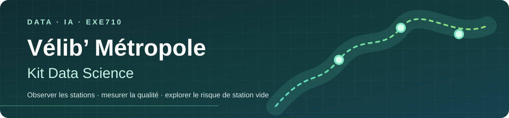
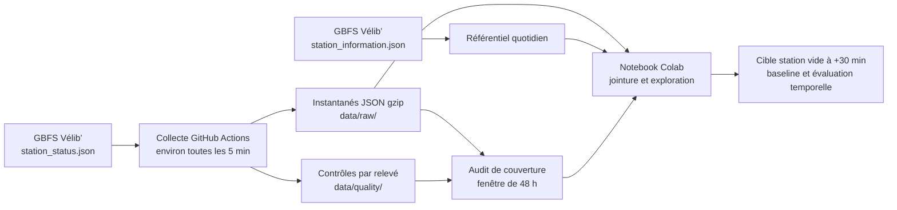

<p align="center">
  
</p>

<h1 align="center">Vélib’ Métropole · Kit Data Science</h1>

<p align="center"><strong>Une station en service sera-t-elle vide dans 30 minutes ?</strong><br>
Projet de groupe · DATA-IA-EXE710 · Télécom Paris · 2026–2027</p>

<p align="center">
  <a href=".github/workflows/collect-velib.yml"></a>
  
  
  
</p>

<table align="center">
  <tr>
    <td align="center"><a href="https://blog.velib-metropole.fr/"><picture><source media="(prefers-color-scheme: dark)" srcset="https://blog.velib-metropole.fr/wp-content/uploads/2023/11/VELIB_LOGO_BLANC.png"></picture></a></td>
    <td align="center"><a href="https://www.telecom-paris.fr/fr/ecole/bref/logos"></a></td>
  </tr>
</table>

> **Projet pédagogique indépendant.** Vélib’ Métropole fournit les données ouvertes étudiées ici ; l’usage de son nom et de son logo n’implique ni partenariat, ni validation, ni affiliation officielle avec le service. Les marques et logos restent la propriété de leurs titulaires.

**Accès rapide :** [Réponse à la question](#réponse-à-la-question) · [Résultats](#résultats-vérifiés) · [Gouvernance des données](docs/gouvernance-donnees.md) · [Démarrer](#reproduire-le-projet) · [Colab](#explorer-dans-google-colab) · [Carte interactive](https://g-akram01.github.io/velib-kit-data-science/carte-stations.html) · [Limites](#limites-et-précautions) · [Équipe](#équipe)

> **Version finale :** le notebook consolidé et le rapport PDF sont disponibles sur la branche principale `main`.

## En bref

Le flux Vélib’ publie une **photographie de l’état courant**, et non un historique. Le projet construit donc son propre historique d’instantanés GBFS horodatés en UTC, mesure leur couverture, puis évalue la cible « station vide exactement à +30 min » avec une séparation chronologique des données.

| Dimension | Choix documenté |
| --- | --- |
| Périmètre | Toutes les stations, sans échantillonnage géographique |
| Cadence | Un passage programmé toutes les cinq minutes environ |
| Période d'analyse retenue | 25 au 30 octobre 2026, six journées denses |
| Historique | JSON gzip sous `data/raw/YYYY-MM-DD/` ; référentiel sous `data/reference/` |
| Contrôle | Mesures par relevé sous `data/quality/` et audit sur 48 h |
| Question | `num_bikes_available == 0` à +30 min, parmi les stations en service |

> **Collecte après la période étudiée :** la cadence s'est dégradée après le 31 octobre. Au dernier relevé du 7 novembre à 15 h 47 UTC, l'audit de la fenêtre glissante de 48 h trouvait 9 instantanés sur 576 attendus (1,56 %), avec un trou maximal de 474 minutes : `complete_48h` était `false`. Ces relevés tardifs ne sont pas mélangés aux analyses ci-dessous.

## Résultats vérifiés

Le [notebook unique](notebooks/01_analyse_finale_velib.ipynb) a été exécuté intégralement sur la période figée du 25 au 30 octobre, avec **1 736 créneaux sur 1 740 attendus (99,8 %)**. Le changement d'heure du 25 octobre explique les 300 créneaux théoriques de cette journée. Les quatre trous observés durent dix minutes chacun.

Parmi les stations en service analysées, **4,8 %** des observations sont vides et **18,3 %** ont au plus deux vélos. Sur le test chronologique, la forêt aléatoire obtient un **F1 de 0,570**, contre **0,562** pour la persistance. Cet écart de 0,008, observé sur une seule coupure temporelle, ne démontre pas un gain robuste. La régression complémentaire du nombre de vélos a une erreur absolue moyenne de 1,45 vélo, contre 1,34 pour la règle « nombre inchangé ».

Le [rapport PDF](docs/rapport-final.pdf) détaille la méthode, les graphiques, les résultats et les limites. Le dossier `notebooks/` contient le notebook final ; les versions précédentes sont conservées dans [branche d'archives](https://github.com/G-Akram01/velib-kit-data-science/tree/archive-notebooks-2026-11-08/notebooks/archive) uniquement à titre d'archives. Une [carte interactive des stations](https://g-akram01.github.io/velib-kit-data-science/carte-stations.html) complète la carte statique du rapport ; ses couches distinguent les stations souvent vides des autres.

Les statuts des douze tâches sont tenus directement dans le [tableau GitHub Projects](https://github.com/users/G-Akram01/projects/2/views/1).

## Réponse à la question

**Peut-on prévoir qu'une station Vélib' en service sera vide exactement 30 minutes plus tard ?** Les relevés permettent de construire une cible future vérifiable, mais le modèle actuel ne démontre **pas** de gain fiable sur une règle très simple : si la station est vide maintenant, la prédire encore vide. Le F1 global de la forêt aléatoire est de 0,570, contre 0,562 pour cette persistance sur le même test chronologique. Pour les stations **encore pourvues de vélos**, qui représentent le cas d'usage le plus utile, la forêt n'en détecte que 10,4 % lorsqu'elles se vident à +30 minutes (précision 35,4 %, F1 0,160). La régression logistique détecte 13,6 % de ces cas (précision 24,7 %, F1 0,176). Le résultat est une preuve de concept descriptive, pas une alerte exploitable en temps réel.

Cette réponse est en outre **conditionnelle** : le jeu de test ne conserve que les stations en service à l'instant initial **et** à +30 minutes. Il écarte donc les stations qui ferment pendant cet intervalle. Les [fermetures temporaires annoncées par Vélib’ pour le 31 octobre](https://blog.velib-metropole.fr/fermeture-temporaire-de-stations-velib-a-loccasion-des-manifestations-2/) ont commencé dès le 30 octobre ; la [Ville de Paris documente aussi celles du 24 octobre](https://www.paris.fr/?photo=26-12). Dans nos relevés, le nombre de stations où `is_renting != 1` est d'environ 20 en milieu de semaine, contre 166 le 25 octobre et jusqu'à 142 le 30 au soir. Le flux n'indique pas la cause de chaque fermeture. Les moyennes du dimanche et les scores du modèle ne représentent donc pas nécessairement une semaine sans perturbation. La [note de gouvernance](docs/gouvernance-donnees.md) décrit ce biais et les règles d'exclusion.

## Du flux à la question scientifique



La collecte sauvegarde chaque réponse compressée avec l’heure de collecte UTC et conserve la date de remontée du flux source lorsqu’elle existe. Les métadonnées des stations sont rafraîchies une fois par jour quand la source répond. Les relevés manquants ne peuvent pas être reconstruits après coup à partir de ce flux instantané.

## Méthode de collecte

- **Toutes les stations et tous les champs bruts** renvoyés par `station_status.json` sont conservés à chaque passage.
- **Toutes les cinq minutes environ**, sans arrêt programmé à 48 h : 288 passages théoriques par jour, soit 576 en 48 h.
- **Référentiel complet** `station_information.json` rechargé quotidiennement : localisation, capacité et noms.
- **Données conservées** : `data/raw/YYYY-MM-DD/*.json.gz` ; métriques de complétude et fraîcheur dans `data/quality/YYYY-MM-DD.csv`.
- **Audit** : `python -m src.audit_collection --hours 48` calcule le taux de relevés, le nombre de stations, les trous de collecte et l’indicateur `complete_48h`.
- **Seuil de contrôle** : un flux de moins de 1 000 stations ou avec des identifiants répétés est refusé. Ce seuil, configurable par `VELIB_MIN_STATIONS`, est une alerte prudente et non une garantie de couverture à 100 %.

Le collecteur continue tant que le workflow reste activé. L’indicateur `complete_48h` exige **au moins 48 h d’historique**, **95 % des créneaux théoriques** et **aucun trou mesuré supérieur à 15 min**. Cette validation dépend des relevés réellement enregistrés.

### Où trouver quoi ?

| Chemin | Rôle |
| --- | --- |
| `src/collect_velib.py` | Appels API, nouvelles tentatives HTTP et sauvegarde JSON gzip |
| `.github/workflows/collect-velib.yml` | Planification et commit automatique des instantanés |
| `data/raw/YYYY-MM-DD/` | Instantanés horodatés et compressés, à ne pas supprimer |
| `data/reference/` | Caractéristiques des stations, rafraîchies quotidiennement quand la source répond |
| `data/quality/YYYY-MM-DD.csv` | Nombre de stations, retard des signalements, stations vides et autres métriques par relevé |
| `src/audit_collection.py` | Bilan de la fenêtre glissante de 48 h |
| `notebooks/01_analyse_finale_velib.ipynb` | Notebook unique exécuté : qualité, exploration, géographie, variables historiques et cible exacte à +30 min |
| `docs/carte-stations.html` | Carte interactive des stations observées, avec couches et informations au survol |
| `docs/rapport-final.tex` et `docs/rapport-final.pdf` | Source LaTeX et rapport de remise compilé |
| `docs/gouvernance-donnees.md` | Provenance, dictionnaire, qualité, droits, biais et conservation |
| `tests/` | Tests unitaires sans connexion réseau |
| `.github/workflows/tests.yml` | Exécution automatique des tests lors des changements hors données |

## Reproduire le projet

### Depuis ce dépôt

```bash
git clone https://github.com/G-Akram01/velib-kit-data-science.git
cd velib-kit-data-science
git switch main
python3 -m venv .venv
source .venv/bin/activate
pip install -r requirements.txt
python -m unittest discover -s tests -v
python -m src.audit_collection --hours 48
```

Ouvrir ensuite `notebooks/01_analyse_finale_velib.ipynb` et exécuter toutes les cellules dans l'ordre. Le notebook est volontairement limité aux dates du 25 au 30 octobre pour que ses résultats soient reproductibles. L'audit sur 48 h mesure la **fenêtre récente** et affiche donc `complete_48h: false` avec les dernières données ; cela n'invalide pas la période historique retenue. Une collecte locale ponctuelle est facultative : `python -m src.collect_velib` ajoute un nouvel instantané et demande un accès réseau.

### Recompiler le rapport LaTeX

Depuis la racine du dépôt, installer [Tectonic](https://tectonic-typesetting.github.io/) et exécuter `tectonic docs/rapport-final.tex --outdir docs`. Le PDF est généré depuis `docs/rapport-final.tex` et les trois figures PNG extraites des cellules exécutées du notebook sous `docs/figures/`. La mise en page actuelle utilise les polices Georgia et Avenir Next disponibles sur le poste de compilation ; sur un autre système, ajuster les deux déclarations `\setmainfont` et `\setsansfont` au début du fichier LaTeX si elles manquent.

Pour lancer la première collecte sur GitHub, ouvrir **Actions → Collecte Vélib toutes les 5 minutes → Run workflow**, puis vérifier les fichiers sous `data/raw/`. Le workflow programmé doit figurer sur la branche par défaut `main`. Si le commit échoue faute de droits, vérifier les permissions GitHub Actions du dépôt et les règles de branche.

<details>
<summary>Initialiser et publier une nouvelle copie avec GitHub CLI</summary>

```bash
cd velib-kit-data-science
git init -b main
git add .
git commit -m "Initialiser le projet Kit Data Science - Velib"
gh repo create velib-kit-data-science --public --source=. --remote=origin --push
```

Utiliser `--private` si le groupe veut restreindre l’accès ; Colab devra alors être autorisé avec le compte GitHub correspondant.

</details>

## Explorer dans Google Colab

Pour ce dépôt public, ouvrir le [notebook unique dans Google Colab](https://colab.research.google.com/github/G-Akram01/velib-kit-data-science/blob/main/notebooks/01_analyse_finale_velib.ipynb). Cette adresse pointe vers la version GitHub utilisée pour le rapport.

Le 8 novembre 2026, ses 53 cellules de code ont été réexécutées dans un environnement Colab neuf, sans erreur. Le F1 de la forêt aléatoire reste de 0,57 et l'erreur de la régression de 1,45 vélo. Les versions des bibliothèques autorisées dans `requirements.txt` peuvent faire varier les chiffres détaillés au millième ; le rapport indique l'environnement utilisé pour ses tables.

```text
https://colab.research.google.com/github/G-Akram01/velib-kit-data-science/blob/main/notebooks/01_analyse_finale_velib.ipynb
```

Chaque membre peut exécuter le notebook et contribuer au même dépôt via branches et pull requests. Pour une copie modifiable sur Drive : **Fichier → Enregistrer une copie dans Drive → Partager**. La version GitHub reste la référence commune.

## Sources des données et des visuels

- [Documentation des données ouvertes GBFS Vélib’](https://www.velib-metropole.fr/fr/donnees-open-data-gbfs-du-service-velib-metropole)
- Flux `station_status.json` : `https://velib-metropole-opendata.smovengo.cloud/opendata/Velib_Metropole/station_status.json`
- Flux `station_information.json` : `https://velib-metropole-opendata.smovengo.cloud/opendata/Velib_Metropole/station_information.json`
- Logo Vélib’ : [version blanche du blog officiel](https://blog.velib-metropole.fr/wp-content/uploads/2023/11/VELIB_LOGO_BLANC.png) pour le mode sombre ; [version couleur répertoriée par Wikimedia Commons](https://commons.wikimedia.org/wiki/File:V%C3%A9lib-M%C3%A9tropole-Logo.png) pour le mode clair.
- Logo Télécom Paris : [page des logotypes de l’école](https://www.telecom-paris.fr/fr/ecole/bref/logos) ; [fichier affiché par un site hébergé par Télécom Paris](https://archi-sec.telecom-paristech.fr/Partners?action=AttachFile&do=get&target=logo_tpt_ltci.png).

Les variables `is_installed`, `is_renting` et `is_returning` du flux GBFS Vélib’ sont documentées sous forme de 0/1 : vérifier la distribution réelle avant conversion. Le schéma peut varier selon les générations GBFS ; le notebook gère plusieurs noms usuels des compteurs de vélos.

## Limites et précautions

- Le `cron` GitHub Actions accepte un intervalle minimal de cinq minutes, mais des exécutions peuvent être retardées ou ignorées. **Auditer la couverture temporelle** avant toute analyse de série.
- Les commits fréquents, 288 par jour en théorie, font croître le dépôt. Cette approche convient à un devoir de quelques jours ; pour plusieurs semaines ou mois, migrer l’historique vers un stockage objet ou une base dédiée.
- Un historique court ne permet pas de conclusions fiables sur les saisons. La prédiction à +30 min est une exploration ou baseline ; un découpage aléatoire créerait une fuite d’information temporelle.
- « Station vide » signifie `num_bikes_available == 0` **parmi les stations en service** (`is_renting == 1`), et non une station simplement fermée.
- Mesurer le décalage entre l’heure de collecte et `last_reported` : les stations ne sont pas toutes mises à jour simultanément.

## Équipe

| Membres du groupe |
| --- |
| Akram GHAZLOUNY |
| Youssef EJJIYAR |
| El Mehdi BEN YAHYA |
| Ahmed HUSSEIN |

**Répartition proposée** : collecte, qualité et reproductibilité ; préparation, jointure et exploration ; cible +30 min, baseline, évaluation temporelle et restitution. Les attributions individuelles restent à décider par le groupe.

## Livrable

Code GitHub, [notebook unique exécuté](notebooks/01_analyse_finale_velib.ipynb), [rapport PDF](docs/rapport-final.pdf), graphiques commentés, limites du jeu de données, sources et méthode de collecte. Date de remise : **8 novembre 2026**.
