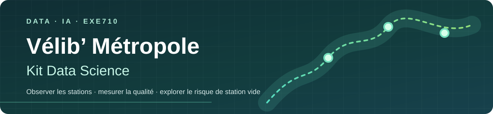
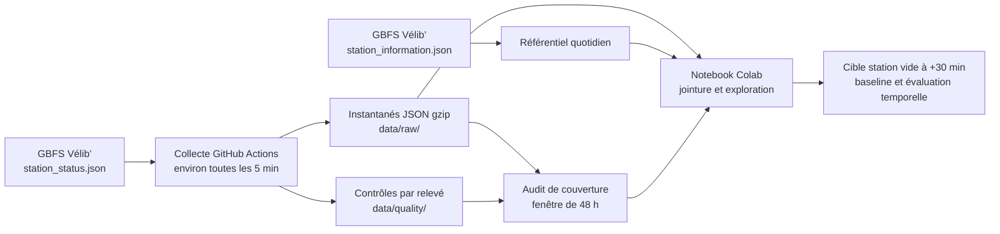

<p align="center">
  
</p>

<h1 align="center">Vélib’ Métropole · Kit Data Science</h1>

<p align="center"><strong>Une station en service sera-t-elle vide dans 30 minutes ?</strong><br>
Projet de groupe · DATA-IA-EXE710 · Télécom Paris · 2026–2027</p>

<p align="center">
  <a href=".github/workflows/collect-velib.yml"></a>
  
  
  
</p>

<table align="center">
  <tr>
    <td align="center"><a href="https://blog.velib-metropole.fr/"><picture><source media="(prefers-color-scheme: dark)" srcset="https://blog.velib-metropole.fr/wp-content/uploads/2023/11/VELIB_LOGO_BLANC.png"></picture></a></td>
    <td align="center"><a href="https://www.telecom-paris.fr/fr/ecole/bref/logos"></a></td>
  </tr>
</table>

> **Projet pédagogique indépendant.** Vélib’ Métropole fournit les données ouvertes étudiées ici ; l’usage de son nom et de son logo n’implique ni partenariat, ni validation, ni affiliation officielle avec le service. Les marques et logos restent la propriété de leurs titulaires.

**Accès rapide :** [Méthode](#méthode-de-collecte) · [Architecture](#du-flux-à-la-question-scientifique) · [Démarrer](#reproduire-le-projet) · [Colab](#explorer-dans-google-colab) · [Limites](#limites-et-précautions) · [Équipe](#équipe)

## En bref

Le flux Vélib’ publie une **photographie de l’état courant**, et non un historique. Le projet construit donc son propre historique d’instantanés GBFS horodatés en UTC, mesure leur couverture, puis prépare une exploration de la cible « station vide à +30 min ». Une prédiction éventuelle reste une **baseline exploratoire**, à évaluer dans l’ordre du temps.

| Dimension | Choix documenté |
| --- | --- |
| Périmètre | Toutes les stations, sans échantillonnage géographique |
| Cadence | Un passage programmé toutes les cinq minutes environ |
| Horizon de collecte | 48 h minimum à auditer ; sept jours souhaités |
| Historique | JSON gzip sous `data/raw/YYYY-MM-DD/` ; référentiel sous `data/reference/` |
| Contrôle | Mesures par relevé sous `data/quality/` et audit sur 48 h |
| Question | `num_bikes_available == 0` à +30 min, parmi les stations en service |

> **État des résultats :** la collecte se poursuit. Le nombre d’instantanés, la couverture réelle et la validation des 48 h doivent être lus dans les données et l’audit ; les chiffres théoriques ci-dessous ne sont pas des résultats observés.

## Du flux à la question scientifique



La collecte sauvegarde chaque réponse compressée avec l’heure de collecte UTC et conserve la date de remontée du flux source lorsqu’elle existe. Les métadonnées des stations sont rafraîchies une fois par jour quand la source répond. Les relevés manquants ne peuvent pas être reconstruits après coup à partir de ce flux instantané.

## Méthode de collecte

- **Toutes les stations et tous les champs bruts** renvoyés par `station_status.json` sont conservés à chaque passage.
- **Toutes les cinq minutes environ**, sans arrêt programmé à 48 h : 288 passages théoriques par jour, soit 576 en 48 h.
- **Référentiel complet** `station_information.json` rechargé quotidiennement : localisation, capacité et noms.
- **Données conservées** : `data/raw/YYYY-MM-DD/*.json.gz` ; métriques de complétude et fraîcheur dans `data/quality/YYYY-MM-DD.csv`.
- **Audit** : `python -m src.audit_collection --hours 48` calcule le taux de relevés, le nombre de stations, les trous de collecte et l’indicateur `complete_48h`.
- **Seuil de contrôle** : un flux de moins de 1 000 stations ou avec des identifiants répétés est refusé. Ce seuil, configurable par `VELIB_MIN_STATIONS`, est une alerte prudente et non une garantie de couverture à 100 %.

Le collecteur continue tant que le workflow reste activé. L’indicateur `complete_48h` exige **au moins 48 h d’historique**, **95 % des créneaux théoriques** et **aucun trou mesuré supérieur à 15 min**. Cette validation dépend des relevés réellement enregistrés.

### Où trouver quoi ?

| Chemin | Rôle |
| --- | --- |
| `src/collect_velib.py` | Appels API, nouvelles tentatives HTTP et sauvegarde JSON gzip |
| `.github/workflows/collect-velib.yml` | Planification et commit automatique des instantanés |
| `data/raw/YYYY-MM-DD/` | Instantanés horodatés et compressés, à ne pas supprimer |
| `data/reference/` | Caractéristiques des stations, rafraîchies quotidiennement quand la source répond |
| `data/quality/YYYY-MM-DD.csv` | Nombre de stations, retard des signalements, stations vides et autres métriques par relevé |
| `src/audit_collection.py` | Bilan de la fenêtre glissante de 48 h |
| `notebooks/01_exploration_velib.ipynb` | Qualité, exploration, jointure et cible +30 min dans Colab |
| `tests/` | Tests unitaires sans connexion réseau |

## Reproduire le projet

### Depuis ce dépôt

```bash
git clone https://github.com/G-Akram01/velib-kit-data-science.git
cd velib-kit-data-science
python3 -m venv .venv
source .venv/bin/activate
pip install -r requirements.txt
python -m unittest discover -s tests -v
python -m src.collect_velib
python -m src.audit_collection --hours 48
```

L’exécution locale est **optionnelle** : la collecte planifiée tourne sur les serveurs GitHub et ne demande pas de garder un ordinateur allumé. Une collecte locale ponctuelle ne remplace pas 48 h de suivi continu.

Pour lancer la première collecte sur GitHub, ouvrir **Actions → Collecte Vélib toutes les 5 minutes → Run workflow**, puis vérifier les fichiers sous `data/raw/`. Le workflow programmé doit figurer sur la branche par défaut `main`. Si le commit échoue faute de droits, vérifier les permissions GitHub Actions du dépôt et les règles de branche.

<details>
<summary>Initialiser et publier une nouvelle copie avec GitHub CLI</summary>

```bash
cd velib-kit-data-science
git init -b main
git add .
git commit -m "Initialiser le projet Kit Data Science - Velib"
gh repo create velib-kit-data-science --public --source=. --remote=origin --push
```

Utiliser `--private` si le groupe veut restreindre l’accès ; Colab devra alors être autorisé avec le compte GitHub correspondant.

</details>

## Explorer dans Google Colab

Pour ce dépôt public, ouvrir le [notebook d’exploration dans Colab]([https://colab.research.google.com/github/G-Akram01/velib-kit-data-science/blob/main/notebooks/01_exploration_velib.ipynb](https://colab.research.google.com/drive/1mU9esIdrviEbBb6u-mb70l7moLGASALp?usp=drive_link)). L’adresse générique est :

```text
[https://colab.research.google.com/github/<UTILISATEUR>/velib-kit-data-science/blob/main/notebooks/01_exploration_velib.ipynb](https://colab.research.google.com/drive/1mU9esIdrviEbBb6u-mb70l7moLGASALp?usp=drive_link)
```

Chaque membre peut exécuter le notebook et contribuer au même dépôt via branches et pull requests. Pour une copie modifiable sur Drive : **Fichier → Enregistrer une copie dans Drive → Partager**. Éviter les copies divergentes et privilégier GitHub pour les versions officielles du projet.

## Sources des données et des visuels

- [Documentation des données ouvertes GBFS Vélib’](https://www.velib-metropole.fr/fr/donnees-open-data-gbfs-du-service-velib-metropole)
- Flux `station_status.json` : `https://velib-metropole-opendata.smovengo.cloud/opendata/Velib_Metropole/station_status.json`
- Flux `station_information.json` : `https://velib-metropole-opendata.smovengo.cloud/opendata/Velib_Metropole/station_information.json`
- Logo Vélib’ : [version blanche du blog officiel](https://blog.velib-metropole.fr/wp-content/uploads/2023/11/VELIB_LOGO_BLANC.png) pour le mode sombre ; [version couleur répertoriée par Wikimedia Commons](https://commons.wikimedia.org/wiki/File:V%C3%A9lib-M%C3%A9tropole-Logo.png) pour le mode clair.
- Logo Télécom Paris : [page des logotypes de l’école](https://www.telecom-paris.fr/fr/ecole/bref/logos) ; [fichier affiché par un site hébergé par Télécom Paris](https://archi-sec.telecom-paristech.fr/Partners?action=AttachFile&do=get&target=logo_tpt_ltci.png).

Les variables `is_installed`, `is_renting` et `is_returning` du flux GBFS Vélib’ sont documentées sous forme de 0/1 : vérifier la distribution réelle avant conversion. Le schéma peut varier selon les générations GBFS ; le notebook gère plusieurs noms usuels des compteurs de vélos.

## Limites et précautions

- Le `cron` GitHub Actions accepte un intervalle minimal de cinq minutes, mais des exécutions peuvent être retardées ou ignorées. **Auditer la couverture temporelle** avant toute analyse de série.
- Les commits fréquents, 288 par jour en théorie, font croître le dépôt. Cette approche convient à un devoir de quelques jours ; pour plusieurs semaines ou mois, migrer l’historique vers un stockage objet ou une base dédiée.
- Un historique court ne permet pas de conclusions fiables sur les saisons. La prédiction à +30 min est une exploration ou baseline ; un découpage aléatoire créerait une fuite d’information temporelle.
- « Station vide » signifie `num_bikes_available == 0` **parmi les stations en service** (`is_renting == 1`), et non une station simplement fermée.
- Mesurer le décalage entre l’heure de collecte et `last_reported` : les stations ne sont pas toutes mises à jour simultanément.

## Équipe

| Membres du groupe |
| --- |
| Akram GHAZLOUNY |
| Youssef EJJIYAR |
| El Mehdi BEN YAHYA |
| Ahmed HUSSEIN |

**Répartition proposée** : collecte, qualité et reproductibilité ; préparation, jointure et exploration ; cible +30 min, baseline, évaluation temporelle et restitution. Les attributions individuelles restent à décider par le groupe.

## Livrable

Code GitHub, notebook exécutable, graphiques commentés, limites du jeu de données, sources et méthode de collecte. Date de remise annoncée dans la fiche du module : **26 octobre 2026 à 18 h**.
